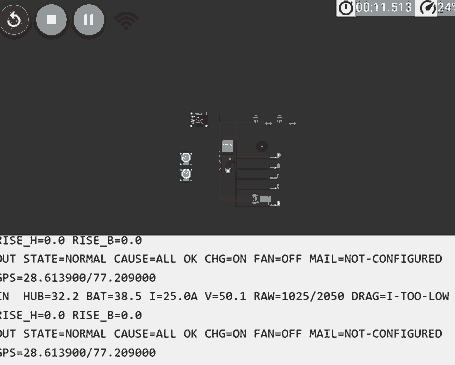

# ThermoGuard EV

**Early thermal warning, staged response and automatic emergency alerts for electric vehicles.**

Team Alpha · Vidyavardhaka College of Engineering (VVCE), Mysuru · PRAYOG '26

> **Problem statement:** EV Battery Overheating Alert. Monitor battery temperature and automatically warn the user when the temperature becomes too high.
> ThermoGuard EV answers it and goes further: it also watches the wheel hub, detects mechanical drag, responds in stages and emails the emergency contacts with the vehicle's location.

---

## Why this exists

In September 2026 a KSRTC electric bus caught fire near Bilikere, Mysuru, with 16 passengers aboard. All of them escaped unhurt. Reports say a jammed rear-right brake overheated the tyre and the fire then spread to the battery; the exact cause is still under examination.

Battery management systems mainly track cell and pack temperature. They do not watch heat building up at the wheels, they do not combine motor current with speed to spot a dragging brake, and a dashboard warning does not tell fire or police teams where the vehicle is. ThermoGuard EV is a low-cost layer that does all three.

## What is in this project

| Part | What it is |
|---|---|
| `firmware/sketch.ino` | Full ESP32 firmware (v3.2): two temperature zones, drag detection, staged response, OLED, relay, fan, GPS and email dispatch |
| `firmware/diagram.json` | Wokwi circuit for the firmware (ESP32, two DS18B20, OLED, LEDs, buzzer, relay, two pots) |
| `firmware/thermoguard_leds.ino` | Small sketch that only drives the tyre/battery warning LEDs. Runs on **ESP32 and ESP8266** |
| `index.html` | Browser simulation: an agent that detects faults, explains its reasoning, picks a fix and carries it out, shown on a 3D (or 2D) bus |
| `ThermoGuard_EV_Idea_Submission.pptx` | Hackathon idea-submission slides |

The folder layout above is a suggestion; keep whatever layout you like.

## How it works

```
 SENSE                    DECIDE                          ACT                     ALERT
 ─────                    ──────                          ───                     ─────
 DS18B20 battery   ┐      zone limits + hysteresis        yellow / red LEDs       email to fire and
 DS18B20 wheel hub ├────► rate-of-rise (10 s window) ───► buzzer, OLED message ──► police control rooms
 motor current     │      drag = high current,            cooling fan             with cause,
 vehicle speed     ┘      low speed                      relay cuts charging     temperatures and a
                          drag + hot hub = escalate                               Google Maps link
```

- **Two zones.** The battery pack and the wheel hub, the two places a bus fire can start.
- **Early warning.** A fast temperature rise raises an alert before any fixed limit is reached.
- **Drag detection.** High motor current while the vehicle is barely moving means a seized brake or bearing.
- **Staged response.** Normal, then warning, then cooling, then critical, so the system reacts in proportion.
- **Non-blocking alerts.** Emails are sent from a separate task on the ESP32's second core, so monitoring never pauses.

---

## 1. ESP32 firmware

### Hardware

| Part | Notes |
|---|---|
| ESP32 DevKit (30-pin) | Powered from USB or a power bank |
| 2× DS18B20 waterproof probes | One at the wheel hub / tyre, one at the battery. 4.7 kΩ pull-up from each data line to 3V3 |
| SSD1306 0.96" OLED (I²C, 0x3C) | Status display |
| NEO-6M GPS module | Optional; without it the sketch uses a fixed test location |
| 2× 10 kΩ potentiometers | Stand-ins for the motor-current sensor and the wheel-speed sensor |
| Active buzzer, green / yellow / red LEDs | LEDs with 220–330 Ω resistors |
| 5 V relay module | Cuts charging. A 24 V-coil relay will **not** switch from 5 V |
| 5 V fan (4010), 2N2222 transistor, 1 kΩ resistor, 1N4007 diode | Fan is driven through the transistor, never from the pin directly |
| Breadboard, jumper wires, USB power bank | |

### Pin map

| Function | ESP32 pin |
|---|---|
| Wheel hub DS18B20 | GPIO4 |
| Battery DS18B20 | GPIO13 |
| OLED SDA / SCL | GPIO21 / GPIO22 |
| Buzzer | GPIO23 |
| Green / yellow / red LED | GPIO25 / GPIO26 / GPIO27 |
| Relay | GPIO32 (HIGH = charging on) |
| Cooling fan (via 2N2222) | GPIO33 |
| Motor current (pot) | GPIO34 |
| Vehicle speed (pot) | GPIO35 |
| GPS RX / TX | GPIO16 / GPIO17 |

All grounds must be joined. If your relay module is active-LOW, swap `RELAY_ON` and `RELAY_OFF` at the top of the sketch.

### Behaviour (v3.2 limits, same for both zones)

| Temperature | State | Outputs |
|---|---|---|
| Below 33 °C | Normal | Green LED |
| 35 °C and above | Warning / cooling | Yellow LED, beeping, flashing OLED showing the cause, cooling fan on. Stays until the zone is below 33 °C |
| 40 °C and above | Critical | Red LED, continuous alarm, relay cuts charging, fan on, email dispatched. Clears at 37 °C or below |

Between 33 °C and 35 °C the state holds, so the lights do not flicker around a limit. All values are demo values at the top of the sketch (`WARN_C`, `WARN_OFF_C`, `FAN_C`, `CRIT_C`, `RESUME_C`, `FAN_OFF_C`) and should be calibrated against real data.

Other detection logic:

- **Rate of rise:** over a 10 s window, 20 °C/min at the hub or 5 °C/min at the battery raises a warning early.
- **Mechanical drag:** current of 60 A or more with speed of 10 km/h or less, held for 3 s, or 90 A or more on its own. The pots scale to 100 A and 100 km/h at full travel.
- **Cross-zone fusion:** drag while the hub is already heating jumps straight to the cooling stage.
- **Sensor faults:** one lost probe gives a warning; both lost is treated as critical because the vehicle is blind.

### Email dispatch

- Gmail SMTP (`smtp.gmail.com:465`) with an **App Password**, sent by a FreeRTOS task pinned to core 0.
- The email names the cause, both temperatures, motor current, speed, fan and charging state, and a Google Maps link.
- A failed send retries every 15 s; a successful one repeats every 5 minutes while the fault persists.
- A TEST email is sent about 5 s after WiFi connects, to prove the path works before any real event. Turn it off with `SEND_TEST_MAIL_ON_BOOT 0`.
- Email is a stand-in for SMS: a SIM800L GSM module is costly and fiddly for a prototype.

### Set-up

1. **Libraries** (Arduino Library Manager): `OneWire`, `DallasTemperature`, `SSD1306Ascii`, `TinyGPSPlus`, `ESP Mail Client` (Mobizt). `Wire` and `WiFi` come with the ESP32 board package.
2. **Board:** ESP32 Dev Module. The full firmware is **ESP32 only**.
3. **Gmail:** turn on 2-Step Verification, then create an App Password.
4. **Edit the top of the sketch:**
   ```cpp
   const char* WIFI_SSID = "YourWiFiName";       // 2.4 GHz only; a phone hotspot works
   const char* WIFI_PASS = "YourWiFiPassword";
   const int   WIFI_CHANNEL = 0;                 // 0 = any channel (6 is a Wokwi-only setting)
   #define SENDER_EMAIL        "yourname@gmail.com"
   #define SENDER_APP_PASSWORD "abcd efgh ijkl mnop"
   #define ALERT_FIRE          "yourname@gmail.com"   // your own address while testing
   #define ALERT_POLICE        "yourname@gmail.com"
   ```
   Never put real fire or police addresses here during testing, and never commit your App Password.
5. **GPS:** with a NEO-6M set `#define SIM_GPS 0`. Without one, keep `SIM_GPS 1`; the email then carries a fixed test location. Change the `GPGGA` line in `feedFakeGps` to your own coordinates if you want it to point somewhere sensible.
6. Upload, open the Serial Monitor at 115200 baud and look for `MAIL: sent to Fire + Police`.

Until the credentials are filled in nothing is sent, and the OLED shows `M:NOCFG`.

### Run it in Wokwi

Open the [Wokwi project](https://wokwi.com/projects/478230170915427329), paste `sketch.ino` and `diagram.json`, and press Play. Click a DS18B20 and change its temperature to see the states change; turn the two pots to demonstrate drag (raise the current pot while the speed pot stays near zero). The Serial Monitor prints inputs and outputs every second.

**Wokwi circuit and Serial Monitor output:**



### Warning-LED sketch (`thermoguard_leds.ino`)

A minimal version for quick hardware bring-up. Yellow blinks at 45 °C or more for the tyre and above 40 °C for the battery; one red LED comes on above 55 °C for either zone, and the hot zone's yellow stays solid. A fast-blinking yellow means a probe is unplugged. It auto-detects ESP32 or ESP8266:

| | ESP32 | ESP8266 NodeMCU |
|---|---|---|
| Tyre probe | GPIO4 | D5 |
| Battery probe | GPIO13 | D6 |
| Tyre yellow LED | GPIO26 | D1 |
| Battery yellow LED | GPIO25 | D2 |
| Red LED | GPIO27 | D7 |

---

## 2. Browser simulation (`index.html`)

A single self-contained page that shows the whole idea without any hardware. A simulated bus drives around a low-poly 3D road while an agent watches the battery, the wheel hub, motor current and speed.

**Run it:** open `index.html` in any modern browser, on a laptop or a phone. The 3D view loads three.js from cdnjs, so it needs internet; without it, or without WebGL, the page falls back to a 2D scene automatically. The *Switch to 2D / 3D* button changes the view.

**Use it:** press one of the *Inject a fault* buttons (they can be combined), then watch the OLED mock-up, the LEDs and the *Agent reasoning and actions* log. *Technician fix* removes the root cause so the agent can restore normal operation; *Full reset* starts over.

### What the agent does

Every fault goes through the same loop, written to the log as it happens:

`OBSERVE` (what was detected) → `DIAGNOSE` (the likely cause, from the live readings) → `PLAN` → `ACT` → `VERIFY` (12 s later: is it contained, or still rising?) with `ESCALATE` and `ALERT` for critical cases.

| Button | Detected as | Typical response |
|---|---|---|
| Jammed brake (drag) | F04 MECH DRAG, then F02 HUB OVERTEMP | Speed limit 0, vehicle stops, fan on |
| Charging overheat | F01 BATT OVERTEMP | Charging relay opened, fan on, speed limit 20 km/h |
| Overcurrent | F05 OVERCURRENT | Speed limit 15 km/h; charging cut if the battery is hot |
| Cooling fan failure | F07 COOLING FAIL | Speed limit 15 km/h, buzzer, service recommended |
| Hub probe unplugged | F08 SENSOR LOST | Speed limit 20 km/h, virtual hub estimate enabled |
| Thermal runaway | F09 THERMAL RUNAWAY | Everything cut, speed limit 0, alarm, passengers evacuate, emergency email logged |

Detection limits used by the page (demo values, separate from the firmware):

| Code | Warning | Critical |
|---|---|---|
| F01 Battery over-temperature | 55 °C | 70 °C |
| F02 Hub over-temperature | 65 °C | 85 °C |
| F03 Fast temperature rise | above 0.8 °C/s | above 1.5 °C/s and over 50 °C |
| F04 Mechanical drag | current above 9 A at 1–25 km/h | as warning, with hub at 65 °C or more |
| F05 Overcurrent | above 14 A | as warning, with battery at 55 °C or more |
| F07 Cooling failure | fan on for 8 s, still heating above 50 °C | as warning, at 70 °C or more |
| F08 Sensor lost | hub probe reads -127 °C | n/a |
| F09 Thermal runaway | n/a | battery 70 °C or more and rising above 1.5 °C/s |

In the 3D scene the hub and battery glow by temperature, smoke, fire, sparks and cooling air appear as faults develop, and at a critical fault the bus stops, sirens flash and passengers walk away from it.

**About the "AI":** the reasoning text is generated by a rule-based reasoner from the live readings. It is not a machine-learning model, it calls no external AI service, and the "emails" in the log are simulated. That keeps the demo fast, repeatable and offline-friendly.

---

## Demo script (about 3 minutes)

1. **Normal:** green LED, OLED shows all normal. Show the two probes: one near a tyre, one near the battery.
2. **Drag:** raise the current pot with the speed pot near zero; the OLED counts down and flags drag.
3. **Warning and cooling:** warm a probe (hairdryer or warm water). At 35 °C the yellow LED lights and the fan starts.
4. **Critical:** at 40 °C the red LED and alarm start, the relay cuts charging, and the emergency email arrives with the map link.
5. **Cooling down:** show the states clearing in the right order (red clears at 37 °C, normal below 33 °C).
6. **Browser simulation:** inject *Jammed brake* and *Thermal runaway* and walk through the agent log.

Warm only the probe, and keep wires and the breadboard dry.

## Testing

- The firmware logic was exercised on a PC against simulated sensors, a simulated WiFi connection and a simulated SMTP server. The threshold checks (33 / 35 / 40 °C for both zones, hysteresis on the way down, a sudden jump to 41 °C), the email retry timing and the no-WiFi case all passed.
- That test does not replace hardware: confirm your own DS18B20 wiring, relay logic, fan transistor and a real Gmail send with the boot TEST email.

## Limitations

- This is a hackathon prototype, not a certified safety system. All thresholds are demo values.
- The potentiometers stand in for a real current sensor (INA219 / ACS712) and a wheel-speed sensor.
- A DS18B20 is rated to 125 °C and is a stand-in; a real brake hub needs a high-temperature probe.
- Email needs WiFi. A production unit would use a GSM or LTE modem for SMS and keep the same alert logic.
- A real pack needs a rated contactor, not a hobby relay, and integration with the vehicle's own BMS.
- The `ESP Mail Client` library is deprecated; ReadyMail is its replacement.
- The firmware thresholds (33 / 35 / 40 °C, scaled for a toy-bus demo) and the browser simulation (battery 55 / 70 °C, hub 65 / 85 °C) are separate sets of demo values.

## Ideas for next steps

Real current and wheel-speed sensors, SMS through a GSM/LTE modem, CAN-bus access to the real BMS, data logging for post-incident analysis, over-the-air updates, and one shared threshold set across firmware and simulation.

## Team Alpha

- Mohammed Khadeer (team leader)
- Zidan Ahmed Siddiqui
- Zuhair Mohammed Ziauddin

Vidyavardhaka College of Engineering, Mysuru.

## Licence

Not yet specified. Add one before publishing the repository.
